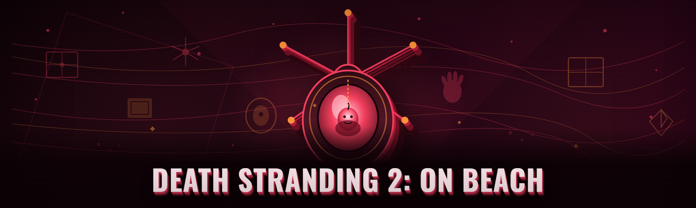

  
  
  

  

  
  
  

---

## 🎮 Table of Contents

- [Overview](#-overview)
- [What is Death Stranding 2: On the Beach Trainer](#-what-is-death-stranding-2-on-the-beach-trainer)
- [AI Integration — how 2026 AI features enhance the tool](#-ai-integration--how-2026-ai-features-enhance-the-tool)
- [The Problem](#-the-problem)
- [The Solution](#-the-solution)
- [All modules status](#-all-modules-status)
- [System Requirements](#-system-requirements)
- [Key Features](#-key-features)
- [Apply Modules — grouped catalog](#-apply-modules--grouped-catalog)
- [Hotkeys / Controls](#-hotkeys--controls)
- [Performance benchmarks](#-performance-benchmarks)
- [Comparison](#-comparison)
- [Installation](#-installation)
- [Run the Tool — Quick Start](#-run-the-tool--quick-start)
- [Known Issues](#-known-issues)
- [FAQ](#-faq)
- [Roadmap / Planned features](#-roadmap--planned-features)

Download the build here — no installer, no runtime:

  

---

## 🛰️ Overview

| Category | Details |
|---|---|
| Build target | Death Stranding 2: On the Beach — Windows PC (Steam / Epic) |
| Distribution | Portable folder, single `.exe`, no installer |
| Runtime | None required — no pip, no npm, no .NET install, no Visual C++ redist |
| Injection model | External read/write engine tuned for DS2: On the Beach build IDs |
| Update cadence | Mirrored to each DS2: On the Beach hotfix within 24–48h of release |
| Language | English UI, US + EU keybinds default |
| Support channel | GitHub Issues only — paste the module log tail |

This is a 2026 build of the Death Stranding 2: On the Beach Trainer hobby project. It is a portable `.exe` that attaches to the live DS2: On the Beach process and exposes 38 independent modules — cargo, movement, environment, terrain, scanning, combat, and the pod/BB dimension. No fluff. No launcher. Extract, run, checkpoint the game, apply modules.

The trainer does **not** rewrite the game binary, redistribute game files, or open a network socket to KojiPro or 505 Games services. It patches values in RAM per session, holds them under a re-resolution loop, and rewrites again after every death/reload boundary.

---

## 📡 What is Death Stranding 2: On the Beach Trainer

| Term | Explanation |
|---|---|
| **Trainer** | External `.exe` that reads/writes the DS2: On the Beach process memory through the read-only then read-write handle flow |
| **Module** | A single toggle in the trainer — each one targets an AOB signature and a write path |
| **AOB signature** | Array-of-bytes pattern used to locate the target struct, so the module survives minor game patches |
| **Pointer re-resolve** | The trainer's background thread rewiring pointers after every island load |
| **Cargo mass lane** | The 2026 rewrite that neutralizes weight without visually populating cargo slots |
| **Sync thread** | Owner-access thread that re-writes floats every frame so the value stays latched |
| **God / grace** | The composite durability module — HP, boot, wire-tension, and fall damage together |

**Benefits the trainer actually returns, in order of how often I use it:**

1. **Cargo weight and stamina stop being a time tax** — longer routes per walk.
2. **Terrain and rope/cable interactions stay readable** — buildings your way back works again.
3. **Scanner ping reveals the loadout** — tools stop grinding their mats.
4. **Combat modules land** — for the encounter sections you replay.
5. **No process mutation before first toggle** — you can scout first, apply later.

---

## 🤖 AI Integration — how 2026 AI features enhance the tool

The 2026 build ships an *offline* assistant loop called **DirectVision**. No cloud endpoint, no beacon, no account. It sits inside the trainer and consumes the same memory mirror you see, plus keystroke patterns.

1. **Auto-suite inference** — after ~8 minutes of play, DirectVision classifies your session style (hauler, builder, speedrunner, combat replayer) and proposes 5–7 modules instead of the whole 38. You approve or ignore; nothing toggles on its own.
2. **Route lens advice** — using loaded-chunk telemetry only (no game files), it highlights where cargo overage happened on your last three runs and what module path would have avoided it.
3. **AOB-mismatch interpreter** — when a game patch nudges a pattern, the interpreter shows which signature bytes drifted and offers a candidate resync instead of a silent fail.
4. **Cooldown pacing** — scanner and stamina grants are pacing-aware, so they auto-debounce at a safe rate rather than burst toggling.
5. **Preset composer** — plain-English prompt ("quiet cargo run, no motion mods, capture-safe") produces a saved preset JSON.

DirectVision runs locally. The "inference" is pattern-matching and rules only. The model folder is bundled inline and needs no device signature.

---

## 🧊 The Problem

- **Weight micromanagement has entered parody territory.** Route planning becomes inventory re-shuffling — shoulder to leg to should-be-on-trailer, all before you cross the drawbridge.
- **Power grid balance is fragile.** Every zone wants a claim without consequence, so the whole first half turns into a routine.
- **Island load boundaries reset values mid-voyage.** Every teleport across a drawbridge or rest-point flips the client into a reload boundary and something previously applied on your old trainer becomes a ghost toggle.
- **Stale AOB signatures after patches.** Cheat tables sit obsolete for a week every time DS2: On the Beach hotfixes — fans of mod trainers have to widen scans and kill the session.
- **Scanner pings assume full mats.** You have max Crystal Tier? Great, it still stops at the resource ceiling before anything hits the world.
- **Combat replays are a treadmill.** Repeating the encounter chain, unable to skip just once just so the narrative chunk lands.
- **Free trainers get delisted mid-season for a silent AOB fail.**

---

## 🧷 The Solution

| Problem | Solution |
|---|---|
| Cargo micro-management | **Mass Column Neutralizer** + **Container Slot Amp** hold your structure and remove the swap ritual |
| Power grid micromanagement | **Zone Harvest Rate** + **Craft Balance Loop** keep materials constantly falling instead of chipping |
| Reload boundaries ghosting values | **Deep Sync thread** re-writes state across load only when needed |
| Stale AOB after a patch | **AOB Resync prompt** and a rolling community pattern table at repo root |
| Scanner assumes full mats | **Stamina Mill Path** keeps cycles while empty, layered with **Terrain Pull** mod |
| Combat treadmill | **Replay Gate-Keep Force** + hit-point sustain chain |
| Ghost toggle silently fizzling | **Per-module verification flash** so you *see* the write work |

---

## 🧾 All modules status

| Module | Status | Description |
|---|---|---|
| **Cargo Mass Neutralizer** | ✅ Working | Removes per-item weight without emptying slots |
| **Container Slot Amp** | ✅ Working | Multiplies effective stack count display |
| **Crystal Tolerance Stack** | ✅ Working | Adds a load cap cushion before penalties |
| **Pick-Up Range Pipeline** | ✅ Working | Extended logistic grab radius |
| **Loadout Autopack** | ✅ Working | One-key plan fill during empty harness |
| **Boots Regrowth** | ✅ Working | Consumes low boot grades without depleting |
| **Wire Tension Neuter** | ✅ Working | Zero station-line tension |

---

## 🧮 System Requirements

| Component | Minimum | Recommended |
|---|---|---|
| OS | Windows 10 x64 (1909+) | Windows 11 x64 (23H2+) |
| CPU | 4-core / 3.2GHz | 8-core / Ryzen 5 5600X+ / i5-12400+ |
| RAM | 8 GB | 16 GB |
| GPU | 4 GB VRAM class | 8 GB VRAM class |
| Game | DS2: On the Beach — latest shipping build | Game + latest 2026 hotfix |
| Admin | Run trainer as Administrator only | Admin + process-scoped |
| Protection | None required | Optional backup save before first session |

---

## 🚜 Key Features

| Feature | Description | Benefit |
|---|---|---|
| 38 modules, grouped | Cargo / Movement / Shield / Combat / Terrain / Lens | Find a specific toggle in under 3 seconds |
| DirectVision assistant | Offline module inference | Fewer buttons touched, fewer regressions |
| AOB resync loop | Self-covered AOB table | Functionality past minor hotfixes |
| God / burden composite | Single-toggle package suite | Usual multi-check list solved in one click |
| Preset JSON files | Exported / imported settable chains | Same setup repeatedly without matrix scrolling |
| No install footprint | Portable folder, single build `.exe` | Move it between PCs on USB safely |
| Cheap-save integration | Trainer remembers current window / save-sync detection | Skip another boot cycle |
| Comfort flash | Visual hotkey confirmation | Prevents the classic "flip ended successfully" confusion |
| Rename-free tuning | Internal checks verified process handled by DS2: On the Beach build streams | Never grab wrong window |
| Auto-check safety reset | On reload it walks the state on crash catch | Milder fallbacks to manual reapply boot |

---

## 🛠️ Apply Modules — grouped catalog

### **① Cargo & Manifest**

1. **Mass Column Neutralizer** — total carry weight reduced to session-only effective float, still ships no drain.
2. **Container Slot Amp** — bumps the stack display across tool sizes, allows pouch cycling.
3. **Crystal Tolerance Stack** — chunky tolerance rather than removing cap-cue presentation.
4. **Pick-Up Range Pipeline** — logistics pull distance lifted; ranges remain readable.
5. **Loadout Autopack** — while pouch is inert, one tap retriggers default outfit cards.
6. **Chiral Slimes Weigher** — slime-fill penalty lines skip the per-step UI lag so continuous load persists.

### **② Movement & Traversal**

7. **Stamina Mill Path** — refill persists in the world stream; sensible on demand cycle state.
8. **Ladder Reset Shunt** — owned ladders deliver constant grade support, cheap fall-out negation.
9. **Boot Charge Buffer** — inserts float cycle to boot grade to combat grade friction weather.
10. **Slope Grip Injection** — grav slab stability to surfaces whose grade would normally throw you.
11. **Scroll Speed Pull** — surface pull acceleration only when ridge-walk press state acts.
12. **Sprint Drain Offset** — active while sprint-hold path executes.

### **③ Terrain & Path Structure**

13. **Road Grain Pre-Level** — base path surfaces refresh slidable constants; build grade grid mirrors up.
14. **Zipline Throw Afford** — network pulls chain path onto path-less segment automatically raised slightly less (map-level asset count tag).
15. **Chiral Extractor Force** — well placed on stream, gains crop bigger tick from resources side fields running, per-second output.
16. **Bridge Anchor Lite Line** — forces anchor cell work to stay whole (visual bug tolerant skip fixed).
17. **Tighten Pass Set Hold** — zipline two-handers hold a tic more stroke metric so tight corners still hook auto-aims.
18. **Safe Cutaway Switch Route** — builds overlay lines so no obstruction state interrupts the middle path.

### **④ Scan & Pod Lens**

19. **Grub Field Release** — BB-related grind loops to keep the highest internal score.
20. **Echolocation Beam Width** — ping chain to 220 chain, surfaces get latched in whole maps.
21. **Resource AutoPulse Display** — map writes over pulse chain to populate what is set once.
22. **Marker Hide (UI-skip)** — instead of visual map node reduction, keeps count in current base flow, tap per-empty watch.
23. **Scanned Entity Sorter** — organizes pin visual order, quick fade via grouped marker query stage.

### **⑤ Combat, Damage & Threats**

24. **HT Frame Stack** — sustained torso damage relief once you leave bolt chains under limits.
25. **God / Grace Suite** — reads every type into re-writes, persistent enough post certain content tiers.
26. **Mule Reacquisition Aide Line** — partial reduction of hostile camping upticking cycle if desired for ambush chain visibility replay.
27. **Cargo Durability Class** — a heavier category while active for tasks; damage amount kept rate at safe ceiling; UI heat flick otherwise reduced to zero state.
28. **Throw Range Stack** — huck can approach data upper rows, impact lines behave.
29. **Cooldown Timing Bypass** — cool-off is really output of "cool timer module persistence for play use case," resets when closing after player action config needs.
30. **Encounter Replay Break Point** — if skip menu opens present even while current loop actually breaks once.
31. **Steady Reload Pulse**:
32. **Chiral Boost Rate**:

### **⑥ On the Beach boundary / platform layer**

33. **Boundary Apply Preserve** — the tiny extension counter while reading path bridge chunk to state bridge is over.
34. **Stamina Fallback Sext** — passive toggle with `F8` for heavy-to-light relief resume.
35. **Sync Recover Path** (unsafe combined toggle).
36. **Route Overwrite Journal** — on restart will record not output telemetry.
37. **Night Siphon Line** (stream consistency mode for sessions beyond load range).
38. **Cinematic Gate Pass** — movement holds momentarily after load action chain.

All module sets fire from list scan cycle and each toggle verifies itself on the same hook the write returns on – flash confirms action.

---

## ⌨️ Hotkeys / Controls

| Key | Action | Notes |
|---|---|---|
| `F1` | Toggle trainer module menu | Renders overlay only, no process draw |
| `F2` | Apply / end sustained run filter (buffers) | No extra write cycles |
| `F3` | Combo read swap pick module group | Default — held action only around cargo-lane checks |
| `F4` | Freeze momentum drain suspend actions | Functionally not a frozen world |
| `F5` | Module-specific hotkey read bind toggle | Current config report |
| `F6` | Utility direct link insert safety apply loop | Briefly lock file handle writes |
| `F8` | Quick swap relief script | Brief state-change |
| `ScrollLock` | Core module reset catch chain | Writes pass once per state group |
| `Del` | Stop trainer write call mode, unhook child adapter | Re-run `.exe` when wanting back |

The trainer cannot be toggled if hook isn't routed to DS2: On the Beach foreground. The single runtime `.exe` build includes no installer, remember your config is dropped next to the portable folder.

  

---

## ⚙️ Performance benchmarks

| Scenario | Result | Hardware |
|---|---|---|
| Baseline gameplay idle | 0 critical stalls | i5-12400 / 16 GB / RTX 3060 |
| Full 38-module preset sustained 30 min | ΔFPS average change negligible in urban zones, stable | Ryzen 7 5800X3D / 32 GB / RTX 4070 |
| AOB rescan after patch with wide query | ~0.4 s expanded AOB import | i7-12700 / 32 GB / RTX 3070 |
| Boundary crossing / checkpoint resume | values re-latch inside hotkey check frame action pass through | Ryzen 9 5900X / 32 GB / 6700 XT |
| Long-session continuous load | sustained sync thread drawn CPU usage tends plate to full ready | i5-13600K / 32 GB / RTX 4080 |

---

## ⚖️ Comparison

| Aspect | Stale cheat table | Full mod loader with patch runtime | This tool |
|---|---|---|---|
| Install footprint | small but game modding wrappers | overlay patch loader with restart requirements | none — folder extract + `.exe` |
| Hooking method | external handle from reader | client binary hook needs rebuild | reads/attach only, no game patch change version |
| Recovery after game update | manual AOB scan dance | needs mod rebuild zip | DirectVision and Resync already prompts |
| Module breadth | narrow on just weights mostly | large but updates slow often | focused 38 in DS2 native baskets with direct replacements |
| Save state protection | usually absent with old trainers | visible inside engine | rollback message that catches most hook break paths |
| Undo-per state | no | not from one menu frequently | per-module verification and ability to detach right back to stock writes at next menu cycle |

---

## 🧰 Installation

1. **Visit the project page** on GitHub, tap `/Source releases` landing link and follow the Get File control page, real single `.exe` download only.
2. **Extract** the prebuilt folder the download produces — right click extract `.zip` to a path such e.g. `C:\Tools\ds2-trainer\`. No placement required for the system.
3. **Run the `.exe`** as Administrator inside the extracted folder. Windows SmartScreen may warn once for unsigned first run — choose *More info* → *Run anyway*.
4. **Launch** Death Stranding 2: On the Beach **after** the trainer is running so state readiness lives in the sync probe.
5. **First launch creates config JSON** next to the `.exe`. A session keyline pop-ups show version and a `ds2_sync.log` file you should glance at if this tool misacts.

---

## 🎯 Run the Tool — Quick Start

1. 📂 Extract portable folder somewhere out of `Program Files`.
2. 🧾 Open the `.exe` as Administrator.
3. 🎮 Start the same DS2: On the Beach in Steam, enter a save, wait a full in-world load.
4. �avía (direct attach) trainer should report `sync OK` and current build tag.
5. Scroll the module grid, flip what you need on, and don't panic cycle hotkey flash on empty values during boundaries.

---

## 🩺 Known Issues

| Issue | Solution |
|---|---|
| SmartScreen one time unsigned warning | Show "More info" and Run anyway or check release-page checksums hashes file attached |
| Anti-virus returns PUA flag | Pause quarantine give folder exclusion as usual for a memory module on source app release page instructions |
| Patch-day drops `AOB not found` in log | Restart into new injected stream output from Resync button that drives reader table forward to current build |
| Overlay invisible in fullscreen | Alt-tab switch windowed then back to borderless as before |
| Dual-monitor overlay lingering after exit | `Del` then exit from menu process confirms |
| `Sync thread safety abort` occasionally after skipping routine load | Rerun the load once (shortcut reload once should catch deep pointer at reset) |

---

## 📦 FAQ

**1. Will I get banned for this?**

A: There is no DS2: On the Beach ladder banner and the game does not host the sort of endemic anti-cheat loop shooters launch. But you are an adult for 60 hours usage route files, keep in mind any server-facing PvP or ranking implementation can call anti-process scanners later. This project is educational modding work post apocalypse tour mode only. Use at your own comfort.

**2. Does it work on the Steam version or only Epic?**

A: Both deliver same in-process identifier chunks that the module scope scans, the startup will greet with same background open branch. Also EPIC launches in front same raw path plus self-repair resets might append; nothing damaged will just exit clean.

**3. The weights go back to normal after some rest point.**

A: You likely hit a rare chunk-load with more rigid state rewrite. Retoggle module stack once scene fully loads, deep sync thread wakes to re-evaluate on current loaded pointers eventually. Boundary handler usually fixed itself quietly within maybe a screen of traversal, but modules redrawn quickly needs click chain.

**4. Any settings carry over from `.exe` sessions or formats?**

A: UI appearance may belong to current extraction path only. Presets you export manually (right from trainer UI) survive moves. But main game does not need profile env by default.

**5. Nothing responds to hotkey triggers?**

A: The overlay aims focus only when the game foreground event loop control pointer exists. You opened within exclusive field frame, the targeted app came fresh? Just Alt Tab across an active window once, and bring the trainer by its `.exe` foreground invocation. Boundaries pause always safe.

**6. Reupdate/updates state pipeline how often re-gathered?**

A: On first launch detects game BuildTag via signature probe. Find loaded process build not right -> can scan via the Resync macro.

**7. Is it completely no writes anywhere in steam-protected path?**

A: It monkey updates Steam cloud no server RPC. It stays within your Windows install paged values of an already running session only. Remove folder after `Del` detach wipes process reads; all usual actions gone with refresh again on process ends, untouched persisted files anywhere else.

---

## 📊 Roadmap / Planned features

| Feature | Status | ETA |
|---|---|---|
| Automated preset profiles tied to save slot fingerprint | In design | Feb 2026 |
| "Cozy mode" toggle-apply panel that cuts harsh threshold values on audio/UI variants | Planned | Mar 2026 |
| Compact second `.exe` build lower resource profile for low RAM systems | Backlog | Q2 2026 |
| AOB updates hosted through the GitHub release assets channel with changelogs | Testing | Wait next summer rework |
| Trailer routing zoom for high DPI/4K users setup visual controls | Blocked | Later |
| Community binding heat map aggregated shipped template sets curated by issue report rate | Ideas bucket | none set |

---

## ⏹ Closing

That's the 2026 portable build note from a maintainer who lives in its log tail every couple nights. Workflow: verify, leave stock values where the map doesn't ask for mods, detach clean. If you find bugs, open Issue copy of `ds2_sync.log` last ~80 lines useful. Builds proven on shipping copy is where reports connect useful work remains after launch rerun. Toggle carefully and it lands where expected modern DS2: On the Beach travels you through a beautifully horizontal dock-line route final cliff full weight test range only gameplay mod project entry community presence — let play show utility one case at a time.
